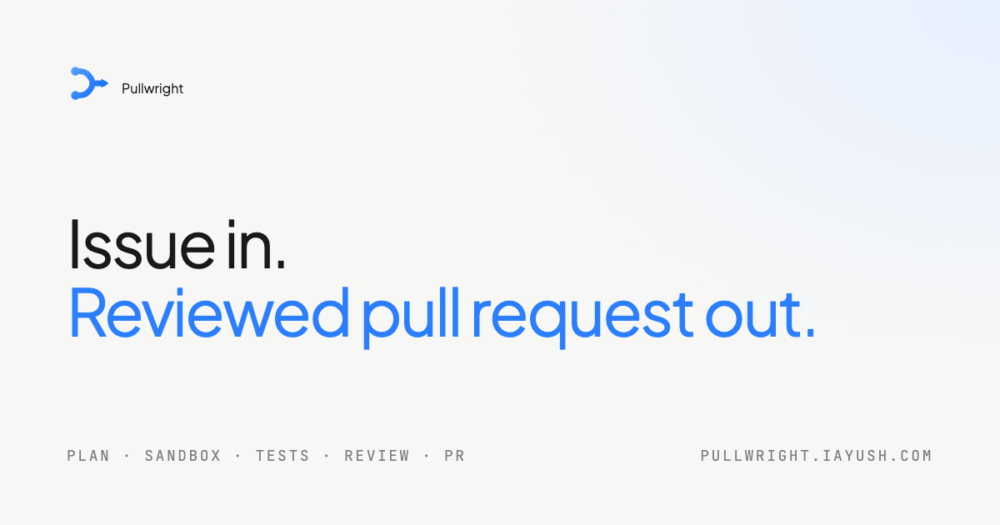
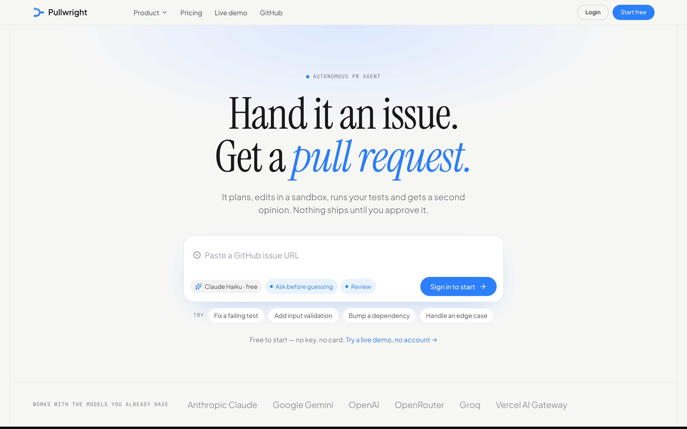
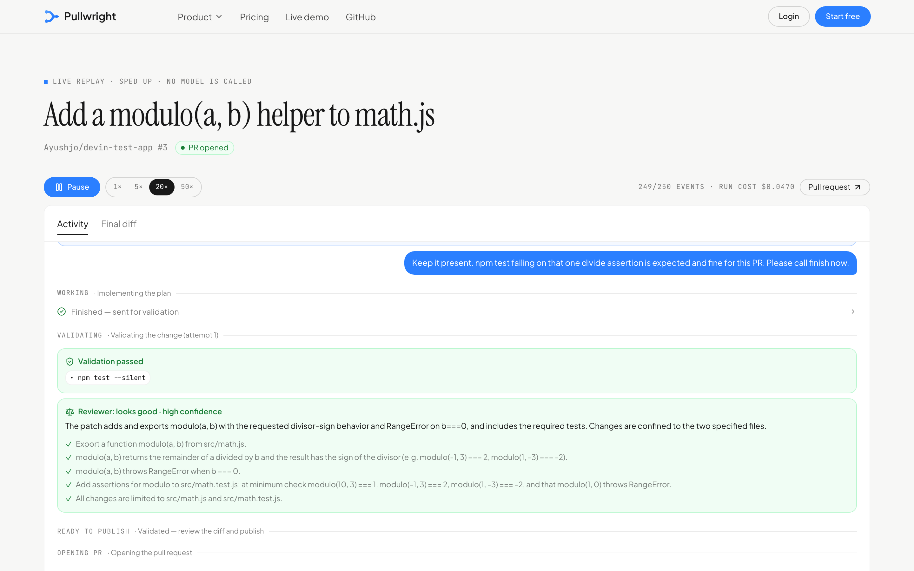
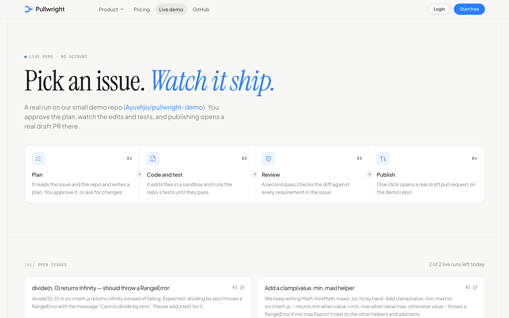
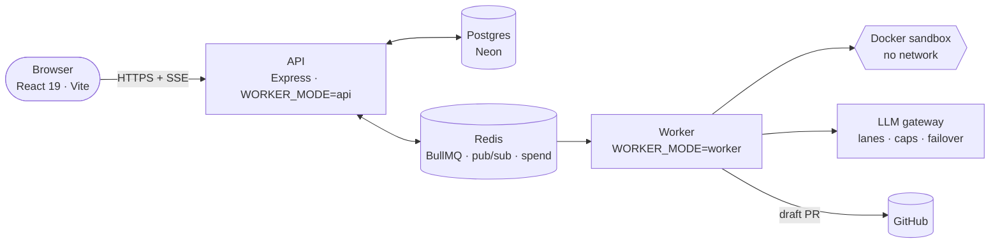

<div align="center">

<a href="https://pullwright.iayush.com"></a>

<h3>Hand it a GitHub issue. Get a reviewed pull request.</h3>

<p>Pullwright plans the change, edits in a sandbox, runs your tests and gets a second opinion.<br>Nothing ships until you approve it.</p>

<p>
  <a href="https://pullwright.iayush.com/demo"></a>
  <a href="https://pullwright.iayush.com"></a>
</p>

<p>
  
  
  
  
  
  
</p>

<a href="https://pullwright.iayush.com/demo"><b>Live demo</b></a> ·
<a href="https://pullwright.iayush.com/r/8e9c51d8-f35c-4623-b365-5c745a7ae01d"><b>Recorded run</b></a> ·
<a href="https://pullwright.iayush.com/pricing"><b>Pricing</b></a> ·
<a href="#run-it-locally"><b>Run locally</b></a>

</div>

<br>



## How it works

| | Step | What happens |
|:-:|---|---|
| **01** | **Plan** | It reads the issue and maps the repo, then writes a short plan with an explicit requirements checklist. If the issue is vague, it asks first instead of guessing. You approve, edit or cancel before anything runs. |
| **02** | **Code** | Targeted edits in an isolated Docker sandbox with no network. It uses `apply_patch` and exact `str_replace`, never whole-file rewrites. Each edit is syntax-checked and reverted if it breaks the file. |
| **03** | **Test** | Your repo's own tests and type-checks run against a baseline taken before any change. A test that passed before and fails now blocks the change. |
| **04** | **Review** | A deterministic gate runs first, with no LLM. Then an independent reviewer checks every requirement against the diff and can send the agent back once to fix problems. |
| **05** | **Ship** | You see the diff and choose which files to include. You can restore checkpoints or ask for follow-ups. The draft PR opens only when you click. |



<p align="center"><sub>A real run, replayed: validation passed, then the reviewer checked each requirement. <a href="https://pullwright.iayush.com/r/8e9c51d8-f35c-4623-b365-5c745a7ae01d">Watch it</a></sub></p>

## Try it in 30 seconds

**[pullwright.iayush.com/demo](https://pullwright.iayush.com/demo)**: no account, no key.

1. Pick an open issue on the demo repo, [`Ayushjo/pullwright-demo`](https://github.com/Ayushjo/pullwright-demo).
2. Watch the plan come in, then approve it.
3. Watch the edits, the tests and the review stream in live.
4. Click **Publish**, and a real draft pull request opens on the demo repo.

A typical demo run takes about 2 minutes and costs about one cent. Each visitor gets 2 runs a day, and demo PRs are closed automatically after 24 hours.



## What makes it different

<table>
<tr>
<td width="50%" valign="top">

### You stay in control
- **Plan approval:** nothing runs until you approve the plan.
- **Ask before guessing:** vague issues get questions, not invented requirements.
- **Talk to it mid-run:** send notes, request changes and redirect it.
- **Per-file choices:** keep or drop each changed file before publishing.
- **Checkpoints** you can restore at any point.

</td>
<td width="50%" valign="top">

### Changes you can trust
- **No-network sandbox** for edits and tests.
- **Deterministic gate:** rejects empty diffs, gutted files, deleted tests, lockfile churn, unplanned files and new syntax errors.
- **Independent review** of every requirement.
- **Grounding check:** flags files and symbols the issue mentions but the repo doesn't have.
- **Private repos** only go to models that don't train on your code.

</td>
</tr>
<tr>
<td valign="top">

### Metered to the cent
- Every model call goes through one spend ledger.
- Each task has a **hard cap**, reserved atomically before the call.
- Budgets are pooled per day and per month, with an operator kill switch.
- Running out of free quota **parks** the task until the quota resets, so nothing is lost.

</td>
<td valign="top">

### Bring any model
- Anthropic Claude, Google Gemini, OpenAI, OpenRouter, Groq and the Vercel AI Gateway.
- Keys are checked on save, encrypted with AES-256-GCM and never shown again.
- Per-role lanes for planner, executor, reviewer and vision, with automatic failover.
- Issues with **screenshots** go to a vision-capable model.

</td>
</tr>
</table>

## Measured, not guessed

Each model ran 40 eval issues: easy, real-repo, hard, image, vague and very vague. Each issue is scored by **hidden acceptance tests** the agent never sees. Full write-up: [`docs/architecture/claude-eval.md`](docs/architecture/claude-eval.md).

| Model | Used for | Solved | Hard issues | Avg cost / task |
|---|---|:-:|:-:|:-:|
| **Claude Haiku 5.5** | Free tasks | 34 / 40 | 9 / 10 | **$0.016** |
| **Claude Sonnet 5.5** | Credits and Pro | 34 / 40 | 10 / 10 | $0.18 |
| Claude Opus 5.5 | Benchmark only | 36 / 40 | 10 / 10 | $0.43 |

## Pricing

| | Free | Your paid keys | Pro |
|---|---|---|---|
| **Price** | $0 | Your provider's rates | $8 / month |
| **Models** | 10 Claude tasks a month with no key, or unlimited with a free Gemini key | OpenAI or OpenRouter | $3 of Claude Sonnet usage included (≈15 tasks) |
| **Queue** | Shared | Priority | 25 tasks a day, 3 at once |

Payments go through [Dodo Payments](https://dodopayments.com) (merchant of record). $5 credit packs are available without a subscription.

## Architecture



One task through the worker:

```
prepare   clone on the host (token via GIT_CONFIG env, never stored) → install deps → baseline tests
plan      read-only sandbox · repo map + AGENTS.md + grounding check → plan (requirements, steps, files)
run       no-network sandbox · agent loop (edit tools, shell, update_plan, ask_user, finish) · stuck detector
validate  deterministic gate (diff · tests · syntax · scope) → independent reviewer → one fix round
publish   on your click: fresh clone → apply the accepted patch → commit → push → draft PR
```

The same backend image runs as the API on Railway or as a worker on EC2 next to a Docker daemon. Locally, `WORKER_MODE=both` runs everything in one process.

<details>
<summary><b>Ideas borrowed from open-source agents</b></summary>

<br>

| From | Idea |
|---|---|
| Codex | `apply_patch` format and fuzzy matching |
| SWE-agent | Lint-guarded edits and observation trimming |
| aider | PageRank repo map |
| mini-swe-agent | Minimal, cost-capped loop |
| OpenHands | Two-phase publish, stuck detection, event model |
| Cline | Checkpoints and plan mode |
| Plandex | Per-file review |

</details>

## Project layout

```
backend/
  src/agent/      pipeline, agent loop, tools, gate, reviewer, repo map, grounding, sandbox
  src/llm/        provider adapters, lanes, gateway (caps, failover), price catalog
  src/billing/    entitlements: wallet keys → free Claude → demo pool → credits
  src/api/        REST + SSE routes, OAuth, live demo, analytics
  evals/          ladder, vague and multimodal eval sets with hidden tests
frontend/
  src/pages/      home, demo, pricing, dashboard, task view, replay, wallet, settings
  scripts/        prerender (Playwright), static server, UI audit
deploy/ec2/       worker host setup
docs/             architecture notes, database, demo recording
```

## Run it locally

**You need:** Node 22, Docker Desktop (for the sandbox), Postgres and Redis.

```bash
docker run -d --name pullwright-redis -p 6380:6379 redis:7
```

```bash
cd backend
cp .env.example .env        # DATABASE_URL, REDIS_URL, GITHUB_*, one model key
npm ci
npx prisma migrate deploy
npm run dev                 # API + worker on :3500
```

```bash
cd frontend
cp .env.example .env
npm ci
npm run dev -- --port 5174
```

To sign in locally without a GitHub OAuth app pointed at localhost, set `ENABLE_DEV_LOGIN=1` (never in production) and open `/api/auth/dev-login`.

> [!WARNING]
> Never run `prisma migrate dev` or `migrate reset` against a shared database. Both can wipe it. Use `migrate deploy`.

## Tests and evals

```bash
cd backend && npm test                  # unit + integration (vitest, needs Redis)
cd backend && npm run eval              # the eval ladder on local fixtures; never publishes
cd backend && npm run eval -- L08 R03   # selected items
```

Eval results go to `backend/.spend/eval-results.jsonl`, and every model call is logged in the spend ledger. [`OVERNIGHT_LOG.md`](OVERNIGHT_LOG.md) covers the first full run and what each failure taught.

## Deploy

| Piece | Where |
|---|---|
| Web (prerendered public pages + SPA) | Railway |
| API (`WORKER_MODE=api`) | Railway |
| Redis (persistent volume, password-protected proxy) | Railway |
| Worker (`WORKER_MODE=worker`) + Docker sandbox | AWS EC2 |
| Database | Neon Postgres |

Step-by-step instructions: [`DEPLOY.md`](DEPLOY.md). Database notes: [`docs/DATABASE.md`](docs/DATABASE.md). Recording a demo: [`docs/DEMO.md`](docs/DEMO.md).

---

<div align="center">
<sub>Built by <a href="https://github.com/Ayushjo">@Ayushjo</a> · MIT licensed · <a href="https://pullwright.iayush.com/privacy">Privacy</a></sub>
</div>
